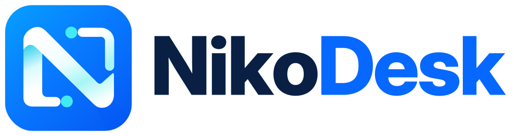
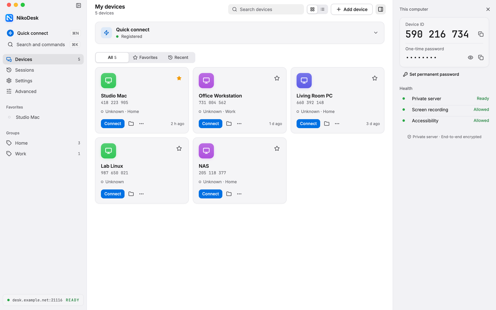
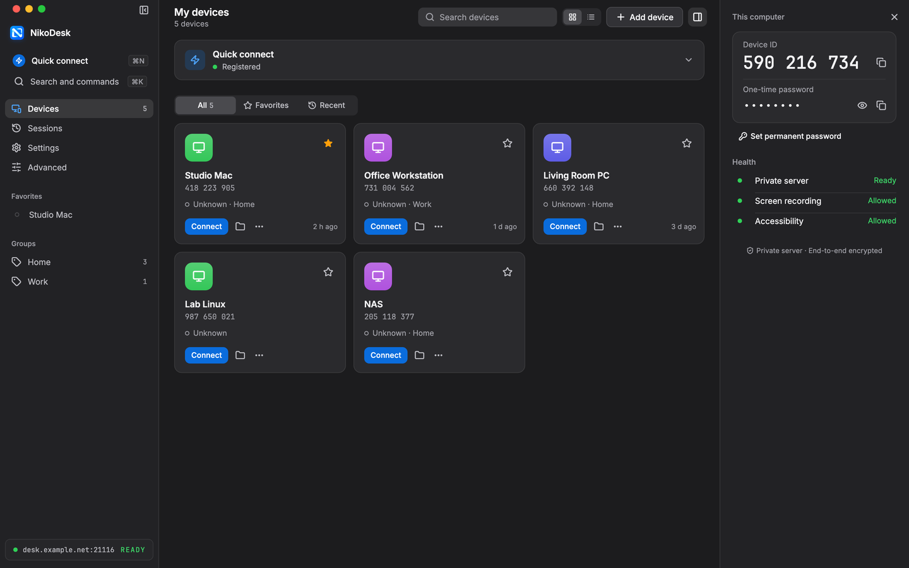

<div align="center">



# NikoDesk

**Your devices. Your server. Your remote desktop.**

A private-server remote desktop built on the native RustDesk core.

[](https://github.com/baogutang/nikodesk/releases)
[](LICENCE)

**English** · [简体中文](README_zh.md) · [Website](https://baogutang.github.io/nikodesk/)

 

*The 3.0 home, rendered from the production Flutter widgets with sample devices, screens and server, without a remote connection.*

</div>

## Current status

The current release is **[NikoDesk v3.0.0](https://github.com/baogutang/nikodesk/releases/tag/v3.0.0)** (product `3.0.0`, build `28`). The main changes:

- a new interface on every device: the home screen leads with the connect panel, the devices you use show their last screen, and Devices, Sessions and Settings share one look;
- Windows ships as an installer only: NikoDesk runs as a background service, so the lock screen, the sign-in screen and administrator prompts can be operated remotely; it is in the Start menu and uninstalls from Settings > Apps;
- controlling a portable Windows host no longer offers an elevation request that cannot succeed, and warns before locking it at the end of a session;
- the iPad and iPhone build warns two days before its free-Apple-ID signature expires.

See the [3.0.0 notes](docs/RELEASE-3.0.0.md) for details, and the [2.2.0 notes](docs/RELEASE-2.2.0.md) for the release before.

**Windows: the installed app gets a new device code and password.** Its service creates its own machine identity; use the code the installer shows on your other devices. The portable app's device list and settings stay.

**Upgrade a controlled Mac from 1.0.x while you are at it.** With the new fixed certificate, Screen Recording and Accessibility must be granted once more; the permission guide at launch walks you through it. Until then, remote sessions show no picture and cannot control the Mac. Later versions keep the same signature and do not need this again.

**From 2.x**, 3.0.0 keeps the same certificate, so the permissions should stay granted. An update under the same certificate has not been rehearsed on a real machine yet; if NikoDesk shows them as not granted afterwards, turn its switch off and on in System Settings.

Packages are generated by the three-platform CI build of the tagged source and come with `SHA256SUMS` and its publisher signature `SHA256SUMS.sig`. The rolling **[nightly preview](https://github.com/baogutang/nikodesk/releases/tag/nightly)** tracks `main`. [Earlier releases](https://github.com/baogutang/nikodesk/releases) keep their own change records.

| Channel | macOS ARM64 | Windows x64 | Android ARM64 |
|---|---|---|---|
| [v3.0.0](https://github.com/baogutang/nikodesk/releases/tag/v3.0.0) / [nightly preview](https://github.com/baogutang/nikodesk/releases/tag/nightly) | DMG + updater ZIP, signed with the fixed NikoDesk certificate (self-signed, not notarized; see Quick start for the first launch) | Installer (`NikoDesk-windows-x64-setup.exe`) with the background service. Unsigned: SmartScreen asks once (More info, then Run anyway). Not yet installed on a real machine; see below. | Controller APK (`io.nikodesk.android`), signed with the dedicated NikoDesk release key and verified against the pinned certificate fingerprint |
| [v1.0.0](https://github.com/baogutang/nikodesk/releases/tag/v1.0.0) | Archived ZIP only | Removed (refused to start) | Removed (refused to start) |

**What is actually verified:** on the developer's Mac, two isolated NikoDesk identities ran real sessions through a private RustDesk server relay — password authentication with video, bidirectional file transfer (SHA-256 verified), TOTP two-factor authentication including replay rejection, session audit records on both ends, the remote terminal (request → local approval → command output), port tunnels (data verified through the tunnel), and picture modes (measurable bitrate/framerate changes). These are same-machine, same-user sessions. On Android 16, a real cross-device session is verified with a locally built test-signed package of the 1.0.8 source controlling the developer's Mac through the private server: password login, HEVC video and touch input (pan/pinch) all worked — the first verified real cross-device Android session, after fixing the launcher crash, the empty-namespace dispatch and the symlinked-storage rejection that blocked every earlier build. That session evidence belongs to the test package of the 1.0.8 source; release APKs are CI-built from each tagged version; Android file transfer, tunnels, extended capabilities and upgrades from earlier installs remain separate acceptance items. Untested combinations stay unclaimed.

The 2.x and 3.0 additions were checked on the same Mac:
- the 2.0 capture and encoding, display-change events and the menu bar session dot ran in real same-machine sessions; the permission guide and the menu bar were checked in the real app;
- the 2.1 interface passes its widget tests, and its macOS build ran in real windows (the permission page and the home in both palettes) and as the controlled side of real same-machine sessions: connection, file transfer, terminal and tunnel;
- the Mac controller's zero-copy decoding was measured in a decoder test (4K HEVC: about 2.0 ms per picture instead of 10.3 ms);
- the 3.0 interface passes its widget tests with the NikoDesk build on and off; its macOS build ran in a real window and as the controlled side of a real same-machine session (first picture in 733 ms), where the controller kept the device's screen as a 480-pixel thumbnail;
- the 2.2.0 changes ran in real sessions from an iPad Pro to the developer's Mac through the private relay, driven by a measuring build of the iPad app: the login-window lock after a session ended (locked in 107 ms), sessions that no longer lock at the start, the click-to-picture timing (median about 33 ms from injected click to captured picture, against 47) and the iPad's decoding and frame rates (60 and 75 frames a second measured).

Not verified yet:
- the Windows installer and its background service on a real machine, including remote unlock: they are built and checked statically in CI only;
- the 3.0 interface on a real Windows or Android device;
- device screens kept from a Mac controller's hardware-decoded pictures in a real session window (the software path was checked);
- the Mac controller's zero-copy decoding in a real session window; if the picture looks wrong, turn off **Use texture rendering** under Advanced → General;
- the privacy-screen fix for full-screen Spaces with a real Space switch;
- installing the system background service and automatic updates on a real machine: the first real automatic update has not happened yet;
- **Lock remote screen** pressed from a controller (the same locking code ran after a session ended);
- the iPad's default picture mode in the regular iPad app (unit tests only), and VideoToolbox decoding on iOS 15 and 16;
- Android was built and package-checked only.

**Implementation scope:** existing source paths include unattended access, wake-on-LAN, privacy screen, virtual display, terminal, camera, tunnels, voice, two-factor authentication, session records and diagnostics, with platform-specific limits. Windows has the unattended service and virtual-display driver paths; macOS and Windows have styled privacy overlays with the legacy blackout retained; a controlled Mac can create virtual displays (from 2.0.0 matched to the controller's screen in pixels, scale and refresh rate) and has an optional system background service for installing updates. Android is a controller, not a controlled endpoint. This is a capability inventory, not completion of the full roadmap; implementation and package checks are not a substitute for per-device acceptance.

## What NikoDesk adds

**New in 2.1**

- **Interface 2.1:** one design system on every platform, with two palettes, Orbit and Clay, each light and dark. One home layout serves desktop, iPad and phone: a sidebar, the device grid or list, an inspector and a command palette (⌘K / Ctrl+K). Settings, session history, session panels, the connection manager, file transfer and dialogs follow it.
- **iPad:** layouts for landscape, portrait and Split View; trackpad pinch zoom, a pointer that follows the app's cursors, hardware-keyboard fixes and two-pane file transfer in landscape. No iPad package is published; [docs/BUILDING.md](docs/BUILDING.md#ipad-controller) describes building and signing it yourself.
- **Zero-copy decoding (Mac controller):** H.264 and HEVC are decoded with VideoToolbox straight into the Flutter texture. In a decoder test a 4K HEVC picture took about 2.0 ms and 0.13 ms of CPU instead of 10.3 ms and 4.7 ms. Texture rendering is on by default and falls back to software rendering after a crash or when no picture arrives.

**New in 2.0**

- **Capture and encoding (controlled Mac):** ScreenCaptureKit by default; pictures up to 4K go straight into a VideoToolbox HEVC session without a copy. Display changes are picked up from system events.
- **Menu bar icon:** shows whether the Mac can be reached and how many remote connections are active, with a dot during a session; its menu copies this Mac's ID, opens the main window or quits. With a menu bar manager such as Ice or Bartender, the new icon may first land in the hidden section; drag it out once and macOS remembers its place.
- **Permission guide:** if Screen Recording or Accessibility is missing at launch, a guide comes first. Each item opens its System Settings pane and the guide refreshes as you grant them; skip it for now or turn the reminder off.
- **Verified updates (macOS):** only releases with a valid publisher signature are accepted. With the optional system background service, updates install and NikoDesk reopens while no remote session is active, and the previous version can be restored.
- **Diagnostics:** local crash records and a redacted diagnostics bundle, exported from Settings and never uploaded.

**Foundations**

- **Private-server first:** your ID server, relay server and server public key. Missing configuration keeps registration stopped; the NikoDesk build disables upstream public-rendezvous fallback.
- **Isolated identity:** its own application ID, configuration, IPC namespace and device keys. An installed RustDesk keeps working untouched beside it.
- **Device workspace:** aliases, groups, favorites, search, online status from real server queries, reconnect controls, and per-server session records (last 200 each).
- **Remembered credentials:** enter the remote password the first time and explicitly choose whether to remember it. After successful authentication, later user-initiated connections can reuse the saved credential without another password prompt. Invalid credentials require fresh authentication. Saved credentials are isolated by server and device in the system secure storage, never plain files.
- **Two-factor authentication:** TOTP with a durable, file-locked replay counter; a used code stays rejected across restarts, and a damaged record disables login instead of downgrading it.

**Sessions**

- **Native core:** RustDesk capture, codecs, input, file transfer, clipboard and multi-display paths are preserved. Picture modes (office / smooth / weak network) change what the controlled side really sends.
- **Video recovery:** a bounded per-display queue preserves encoded reference order, coalesces frame notifications and recovers from overload at a keyframe. A display without a decode estimate no longer disables the other displays' frame-rate feedback. Real VP8, VP9 and AV1 regression fixtures verify decoded pixels; real-network latency is still unmeasured.
- **Quick actions:** desktop and mobile sessions share copy, paste, select all, undo, save, switch application, fit-to-window and original-size controls. Keyboard shortcuts follow the remote operating system, recheck the current session and input permission, and release held keys after failure.
- **Cross-platform keys**: common Ctrl+C/V/X/A/Z/S/F/P/R editing shortcuts from Windows/Linux to Mac use Command automatically. Switch to original keys within the session for terminal Ctrl+C interruption. Control+arrow keeps its Mac Space meaning.
- **Full-screen apps and Spaces**: quick actions expose previous/next Space, Mission Control, app windows and previous/next app. Custom remote shortcuts and macOS Space settings affect the result; arbitrary full-screen windows are not enumerated or directly selected.
- **Connection feedback and diagnostics:** the quality panel shows the connection route (direct or relayed), the time of each connection step, and the controlled side's capture size, encoder, new pictures per second, frame limit and stage times. These are labelled observations, not latency promises.
- **Extended capabilities, all off by default:** remote terminal, port tunnels, camera and voice (including receiver-initiated calls) each need a local per-capability policy and an approval from the controlled side's connection manager, which can revoke mid-session.

- **Update channel selection:** choose stable releases or the nightly preview, shown with the release name and time. Nightly is a manual download and never claims that its rolling tag makes this build outdated.

**Controlled-endpoint features**

- **Unattended access (Windows):** single-file installer, service lifecycle with recovery, machine-level permissions (virtual display, lock-on-disconnect, privacy screen, remote restart) default-off, and password rotation. The setup-validation installer is for test machines.
- **Privacy screen & virtual display:**
  - Choose Nightline, Deep field, Aurora, Graphite or your own image from the controller, with adjustable animation, glow, brightness and clock.
  - Use the optional connection reminder, or remember automatic activation per device.
  - macOS and Windows use native overlays with visible status and a local exit shortcut that requires the system login password.
  - Mac virtual displays match the controller's screen. Windows virtual displays use upstream's signed Amyuni driver, bundled and byte-pinned in the package.
- **Wake-on-LAN:** wake a whitelisted machine directly, or through an authorized tunnel proxy when the controller is remote.
- **Lock on disconnect** and **remote restart**, each permission-gated.

Light and dark themes follow the system or your choice, in the Orbit or Clay palette; the interface ships in English and 简体中文. Extended capabilities await real cross-device acceptance; some Android Bluetooth combinations are unsupported; unmeasured behavior stays unclaimed.

## Windows controlling Mac and full-screen apps

Choose automatic or original keys in **Control center → Local keyboard → Mac**. Automatic maps common Ctrl editing chords to Command; use original keys for terminal Ctrl+C interrupts. Map and Legacy modes support this feature. Combinations containing Shift, Alt/AltGr or Meta retain their meaning.

| Task | Control center action | Default Mac shortcut |
|---|---|---|
| Browse Spaces containing full-screen apps | Previous / next desktop | Control+← / → |
| View Spaces and windows | Task overview | Control+↑ |
| View the active app’s windows | App windows | Control+↓ |
| Switch apps | Switch / previous app | Command+Tab / Command+Shift+Tab |

These actions target the remote system. Local zoom and local full screen change only your view. Remote Mac settings determine whether switching an app also changes Space; customized system shortcuts affect the result.

## Sending fewer pixels

A 5K Mac captures `5120×2880` pixels per frame. A 4K controller cannot show nearly half of them, and every whole-screen change, such as unlocking or entering full screen, has to carry all of them.

**Control center → Picture size sent** (both ends on 1.0.5 or later, controlled side a Retina Mac): the controller says how wide a picture it can show, and the controlled Mac scales its capture towards that without touching its display mode or window layout. The scale moves in quarter steps of the Mac's point size, never below one pixel per point, and only to steps that give whole even pixel sizes; a display with no such step is captured at its native size. *Fit this screen* is the default: a controller reporting a 3840-pixel-wide screen gets `3840×2160` from a 5K Mac. *Smaller* is the Mac's standard size, one pixel per point (`2560×1440` on that Mac). *Remote native size* sends everything. The choice is saved per device; with several controllers the widest request wins. In single local runs at 90% quality and a 60 frame limit, with a window changing its whole content every two seconds, the picture was up to 954 ms behind at native size and up to 17 ms behind at 3840 and at 2560 pixels wide, while decoded frame rate and frame gaps were the same at all three sizes; a second native-size run stayed within 20 ms. Both ends were on one Mac, so none of this is a cross-device result, and no improvement in smoothness is claimed.

**Privacy screen:** allow it on the controlled computer under **Settings → Session security → Allow privacy screen for new connections** (off by default), and allow keyboard and mouse input for the session. The connection reminder offers **Turn on** or **Not now**; remember automatic activation for this computer there or in Control center. Open **Control center → Privacy screen** to choose Nightline, Deep field, Aurora, Graphite, or import a PNG/JPG/WebP picture. Adjust animation, glow, brightness, the clock and the restore hint; privacy status and the exit shortcut stay visible. A successful reply saves the device's style. On the controlled Mac, **Control + Option + Shift + Esc**, or **Esc** on Windows, opens a local prompt requiring the current account's **system login password** (not a Windows PIN). Turning privacy off from the controller or disconnecting still restores the screen. Older endpoints retain their version's exit behavior.

**Frame rate** (1.0.6): the custom limit goes to 120 and **Responsive control** asks for this screen's refresh rate (60 to 120). A controlled computer sends no more new pictures than its own display refreshes.

**In 1.0.7**, automatic capture follows the session's visible canvas and its own display scale; Responsive control follows that window's display refresh rate. Window changes are debounced, while native capture, original/custom zoom and manually chosen FPS retain their intent. If automatic resolution matching changes the display mode without reducing the captured pixels, it restores the recorded previous mode when the reported mode still matches that request and the user has not made a later manual choice. These changes have automated regression coverage; physical monitor moves, Retina pointer accuracy and performance gains remain unverified.

**Control center → Remote resolution → Match this screen** also works with a controlled side older than 1.0.5 and switches the controlled display to the smallest mode, in its original aspect ratio, that still fills the controller's screen (`1920×1080` Retina, captured as `3840×2160`, for that pair). **Restore original** switches back. The controlled side also restores its mode when the last remote-control session disconnects, as long as NikoDesk there is still running. **Match automatically for this device** is off by default; when on, it matches after each connection unless the remote display is already in a non-original mode.

This changes the real display mode of the controlled computer, so anyone sitting at it sees the change, and a smaller Retina mode enlarges its interface. It needs input permission and one selected, non-virtual display. On a controlled computer without Retina scaling, a mode you pick by hand is remembered for that device and applied again on later connections until you restore the original. In a local measurement (both ends on one Mac) the matched mode sent about a third of the data and the frame rate did not change; see the [1.0.4 notes](docs/RELEASE-1.0.4.md).

## Getting started

1. Download from **[v3.0.0](https://github.com/baogutang/nikodesk/releases/tag/v3.0.0)** and verify against its `SHA256SUMS`.
   - macOS: drag the complete `NikoDesk.app` from the DMG into Applications. It is signed with the fixed NikoDesk certificate (self-signed) and not notarized, so macOS blocks the first launch: click **Open Anyway** in System Settings → Privacy & Security (on macOS 14 and earlier, right-click → Open also works).
   - Windows: run `NikoDesk-windows-x64-setup.exe` as your ordinary user (SmartScreen: More info, then Run anyway), confirm your private server, set the service password and choose Yes at Windows' administrator prompt. NikoDesk then runs as a background service and is in the Start menu; uninstall it from Settings > Apps.
   - Android keeps the same application ID and release signing key, with build number 28. Password login, video and touch were verified on Android 16 using a test-signed build of the 1.0.8 source; that version's notes retain the evidence.
2. Configure your own [RustDesk Server OSS](https://github.com/rustdesk/rustdesk-server) in **Settings → Private server**: ID server, relay and **server public key**. Keep server private keys on the server.
3. Configure the other endpoint with the same servers and public key. Check service reachability, registration, then password authentication in a real session; each proves something different.
4. A Mac used as a controlled endpoint needs Screen Recording (capture) and Accessibility (remote input); the permission guide at launch takes you through both. From 1.0.5, a valid password connects without a click on the controlled computer: the one-time password the app shows, or a permanent password once you have set it and allowed it. Such a session gets screen, keyboard and mouse, clipboard and file transfer by default. A wrong password or none still raises the confirmation prompt there. 1.0.4 and earlier waited for a click by default even with the right password, and a device updated from them moves to the new rule; to require a click for every session, choose click-only under Security in advanced settings after updating. Each extended capability still asks.

## Network and updates

Registration and relay use your configured infrastructure. Authenticated peer-to-peer sessions also contact the negotiated peer address. Update checks and downloads contact GitHub, including its API and release-asset hosts. “Private server” does not mean every network packet goes to your own server.

**Settings → Software update** offers Stable and Nightly preview. Stable is checked every 6 hours, and only releases whose `SHA256SUMS` carries a valid publisher signature (`SHA256SUMS.sig`, checked against a public key built into the app) are accepted:

- **Without the system background service**, a verified download is offered for manual installation: quit NikoDesk, replace the app in Applications and open it again.
- **With the system background service**, installed under **Settings → Unattended access** with one administrator password, choose **Install when idle**: the update installs and NikoDesk reopens while no remote session is active. If the replaced app fails its check, the previous version is put back; you can also **Restore the previous version** yourself. The service accepts only packages signed with the NikoDesk certificate and runs only its own copy in a root-owned directory.
- **Upgrading from older versions:** 1.0.11 and earlier do not install 2.x or 3.0 by themselves; download it from the release page. 2.x installs 3.0.0 by itself only with the system background service and **Install when idle**; otherwise it is offered for manual installation.
- **Windows and Android** install manually: on Windows run the newer installer and choose **Upgrade the installed service**, which keeps its device code and password; Android upgrades follow the increasing build number.

SHA256 checks that files are intact; the publisher signature shows the manifest comes from the holder of the release key. Neither is Apple notarization.

## Build from source

The native core must be built before Flutter. For macOS ARM64, first prepare the pinned Rust/Flutter toolchains, Xcode and vcpkg native dependencies described in [the build workflow](.github/workflows/release.yml). Set `VCPKG_ROOT` to that prepared vcpkg directory; use a project-local toolchain rather than changing a global SDK.

```bash
git clone https://github.com/baogutang/nikodesk.git
cd nikodesk
cargo build --locked --lib --release \
  --features flutter,hwcodec,unix-file-copy-paste,screencapturekit,nikodesk
cp target/release/liblibrustdesk.dylib target/release/librustdesk.dylib
cd flutter
flutter pub get
FLUTTER_XCODE_ARCHS=arm64 FLUTTER_XCODE_ONLY_ACTIVE_ARCH=YES \
  flutter build macos --release --dart-define=NIKODESK=true
```

The output is `flutter/build/macos/Build/Products/Release/NikoDesk.app`. Packaging and signing are separate steps. The workflow pins Rust 1.88.0, Flutter 3.24.5 and vcpkg dependencies. Public build scripts allow inspection and rebuilding; byte-for-byte reproducibility has not been established. Windows and Android require their own native toolchains and runtime validation. The iPad controller app has no published package; [docs/BUILDING.md](docs/BUILDING.md#ipad-controller) describes building it and signing it with your own Apple ID.

## Security and verification limits

- Uses upstream encryption and authentication; a server public key is not a remote-control password. Device private keys and server private keys have different owners and must not be copied between them.
- From 1.0.5 a valid password (the one-time password the app shows, or a permanent password that was set and allowed) connects without confirmation on the controlled side and gets screen, keyboard and mouse, clipboard and file transfer by default; a wrong password or none still raises the confirmation prompt there. Permission controls must be tested on the actual controlled platform. Set them to what you need rather than granting everything for convenience.
- macOS artifacts are signed with the fixed, self-signed NikoDesk certificate, without Apple Developer ID signing or notarization; the system background service accepts only callers and packages signed with that certificate. Android APKs are signed with the dedicated NikoDesk release key; real-device installs and upgrades remain unverified. Windows artifacts are unsigned.
- Full cross-device testing, file/clipboard behavior, permission revocation and performance comparisons are separate acceptance work. No unmeasured speed or latency improvement is claimed.

## Project and license

- [Website](https://baogutang.github.io/nikodesk/) · [Issues](https://github.com/baogutang/nikodesk/issues) · [Release archive](https://github.com/baogutang/nikodesk/releases)
- [Original upstream README](docs/README_RUSTDESK_UPSTREAM.md)

NikoDesk is an independent downstream of [RustDesk](https://github.com/rustdesk/rustdesk), based on commit `e9ddbd8f` (1.5.0-pre). Its native remote-control core and upstream copyright notices are preserved. It is not affiliated with or endorsed by RustDesk.

[AGPL-3.0](LICENCE). Distributions and modifications must comply with the full license, including its corresponding-source obligations.
