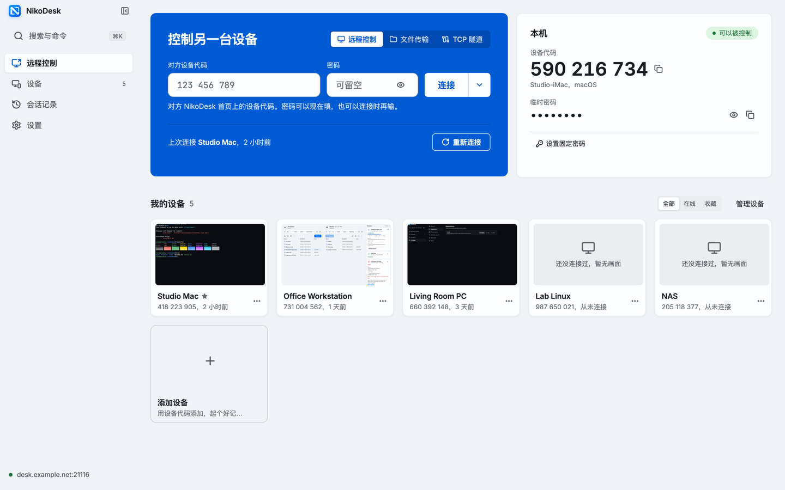
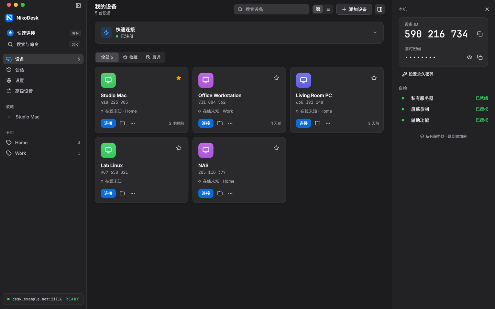

<div align="center">


# NikoDesk

**你的设备，你的服务器，你的远程桌面。**

基于 RustDesk 原生内核、使用自建服务的远程桌面。

[](https://github.com/baogutang/nikodesk/releases)
[](LICENCE)

[English](README.md) · **简体中文** · [官网](https://baogutang.github.io/nikodesk/zh/)

 

*2.1 主页（Orbit 配色），由生产 Flutter 组件渲染，设备和服务器均为虚构数据，不建立远程连接。*

</div>

## 当前状态

当前正式版为 **[NikoDesk v2.2.0](https://github.com/baogutang/nikodesk/releases/tag/v2.2.0)**（产品版本 `2.2.0`、构建号 `27`）。主要变化：

- 被控 Mac 改为通过登录窗口锁屏，并确认确实锁上了，适用于会话结束后锁屏（开启该选项时）和“锁定远程屏幕”；快捷键只作为后备，所以改了触发角或快捷键也不会让 Mac 停在未锁状态；
- 控制端在会话开始时不再把远程指针移到左上角，以前这可能触发 Mac 的“锁定屏幕”触发角；
- 被控 Mac 在点击后立刻抓取新画面：从点击到采集到画面约少 14 ms；
- iPad 上（从源码构建，不提供 iPad 安装包）：H.264 和 HEVC 改用 VideoToolbox 解码（每帧约 6 ms，原来约 20 ms）；没选过画面模式的设备默认用“流畅”，按 iPad 的刷新率请求帧率，不再是每秒 30 帧。

详见 [2.2.0 版本说明](docs/RELEASE-2.2.0.md)，之前的版本见 [2.1.1](docs/RELEASE-2.1.1.md) 和 [2.1.0 版本说明](docs/RELEASE-2.1.0.md)。

**从 1.0.x 升级被控 Mac，请在电脑前操作。** 签名换成固定证书后，屏幕录制和辅助功能需要重新授权一次，启动时的权限引导会带你完成。授权完成前，远程连接看不到画面，也不能操作。之后的版本保持同一签名，不需要再授权。

**从 2.0.0 或 2.1.x 升级**：2.2.0 用同一个证书签名，授权应当保留。同证书升级还没有在真机上演练过；如果升级后显示未授权，在系统设置里把 NikoDesk 的开关关掉再打开。

安装包由打标签源码的三端 CI 构建生成，附带 `SHA256SUMS` 和它的发布签名 `SHA256SUMS.sig`。滚动更新的 **[nightly 预览](https://github.com/baogutang/nikodesk/releases/tag/nightly)** 跟随 `main`，[历史版本](https://github.com/baogutang/nikodesk/releases)保留各自的改动记录。

| 渠道 | macOS ARM64 | Windows x64 | Android ARM64 |
|---|---|---|---|
| [v2.2.0](https://github.com/baogutang/nikodesk/releases/tag/v2.2.0) / [nightly 预览](https://github.com/baogutang/nikodesk/releases/tag/nightly) | DMG + 更新 ZIP，固定 NikoDesk 证书签名（自签名，无 Apple 公证；首次打开见“快速开始”） | 便携 EXE/ZIP（免安装，可与 RustDesk 并存运行）＋用于验证安装流程的无人值守安装器。未签名：Windows 可能显示安全提示。安装器会改动系统，请先在测试机上使用。 | 控制端 APK（`io.nikodesk.android`），使用专用 NikoDesk 发行密钥签名，并对照固定证书指纹校验 |
| [v1.0.0](https://github.com/baogutang/nikodesk/releases/tag/v1.0.0) | 仅保留归档 ZIP | 已移除（拒绝启动） | 已移除（拒绝启动） |

**实际验证过的内容：** 在开发者的 Mac 上，两个相互隔离的 NikoDesk 身份经由自建 RustDesk 服务器中继运行过真实会话——带视频的密码认证、双向文件传输（经 SHA-256 校验）、含重放拒绝的 TOTP 双重验证、两端的会话审计记录、远程终端（请求 → 本机批准 → 命令输出）、端口隧道（数据经隧道验证）、画质模式（可测量的码率/帧率变化）。这些都是同机、同用户会话。Android 16 上已用本地构建、测试签名的 1.0.8 源码包完成**真实跨设备会话**：手机经私服控制开发者的 Mac——密码登录、HEVC 画面与触控（拖动/双指缩放）全部工作，这是项目首次验证的真实 Android 跨设备会话（此前依次修复了必现秒退、空命名空间派发与符号链接存储拒绝三个阻断）。这项会话证据来自 1.0.8 源码的测试包；正式 APK 由对应版本源码经 CI 构建；Android 文件传输、隧道、扩展能力与旧版本升级仍属单独验收项，未测试的组合保持不作宣称。

2.0 和 2.1 的新功能同样在这台 Mac 上验证过：
- 2.0 的采集与编码、显示器变化事件、菜单栏的会话圆点，都在两端同机的真实会话中跑过；权限引导和菜单栏在真实 App 里检查过；
- 2.1 新界面通过了界面单元测试；它的 macOS 构建在真实窗口里打开过（权限页、两套配色的主页），并作为被控端跑过两端同机的真实会话：连接、文件传输、终端和隧道；
- Mac 控制端的解码直通在解码测试中测过（4K HEVC 每帧约 2.0 ms，原来约 10.3 ms）；
- 2.2.0 的改动在 iPad Pro 经私服中继连接开发者 Mac 的真实会话中跑过，由 iPad 测量版自动操作：会话结束后的登录窗口锁屏（107 ms 锁上）、会话开始时不再锁屏、点击到画面的计时（从注入点击到采集到画面中位约 33 ms，原来约 47 ms），以及 iPad 的解码和帧率（实测 60 和 75 帧/秒）。

还没有验证的：
- 2.1 新界面在 iPad、Windows、Android 真机上的运行；
- Mac 控制端的解码直通还没有在真实的远控窗口里看过画面；如果画面显示异常，在“高级设置 → 常规”里关闭“使用纹理渲染”；
- 隐私屏全屏空间的修复，还没有在真实的空间切换中检查；
- 系统后台服务的安装和自动更新没有在真机上演练过，第一次真实的自动更新还没有发生；
- 2.1.1 的设备列表和 Windows 提示只在单元测试里验证过；
- 从控制端按“锁定远程屏幕”（会话结束后锁屏走的是同一段代码，已验证）；
- 正式 iPad App 里的默认画面模式（只有单元测试），以及 iOS 15、16 上的 VideoToolbox 解码；
- Windows 与 Android 只做了构建和安装包检查。

**实现范围：** 现有源码包含无人值守、网络唤醒、隐私屏、虚拟屏、终端、摄像头、隧道、语音、双重验证、会话记录与诊断等路径，具体能力受平台限制。Windows 有无人值守服务和虚拟屏驱动路径；macOS 和 Windows 支持样式隐私屏，旧黑屏路径保留；macOS 被控端可以创建虚拟屏（2.0.0 起按控制端屏幕的像素、缩放和刷新率生成），并有可选的系统后台服务用于安装更新；Android 仅做控制端，不提供手机被控能力。这里列的是已有能力，不表示全部规划已完成；源码实现与包检查不能替代逐设备验收。

## NikoDesk 增加了什么

**2.1 新增**

- **全新界面 2.1**：所有端共用一套设计系统，两套配色 Orbit 和 Clay，各有浅色和深色。桌面、iPad 和手机共用一套主页：侧边栏、设备网格或列表、设备详情面板和命令面板（⌘K / Ctrl+K）。设置、会话记录、会话面板、连接管理、文件传输和对话框都换成新界面。
- **iPad**：横屏、竖屏和分屏宽度的排版；触控板捏合缩放、指针跟随 App 的光标、硬件键盘修复，横屏时文件传输两侧并排。不提供 iPad 安装包，自行构建和签名的方法见 [docs/BUILDING.md](docs/BUILDING.md#ipad-controller)。
- **解码直通（Mac 控制端）**：H.264 和 HEVC 用 VideoToolbox 解码，画面直接交给 Flutter 纹理。解码测试中，4K HEVC 每帧约 2.0 ms、CPU 约 0.13 ms，原来约 10.3 ms 和 4.7 ms。纹理渲染默认开启，崩溃或收不到画面时自动改用软件渲染。

**2.0 新增**

- **采集与编码（被控 Mac）**：默认用 ScreenCaptureKit 采集，4K 及以下的画面直接进入 VideoToolbox HEVC 会话，中间不复制。显示器变化由系统事件触发。
- **菜单栏图标**：显示能否被连接和远程连接数，有会话时图标带圆点；菜单可以复制本机 ID、打开主窗口、退出。用 Ice、Bartender 等菜单栏管理工具时，新图标可能先落在隐藏区，拖出来一次后系统会记住位置。
- **权限引导**：启动时缺少屏幕录制或辅助功能，会先显示引导页。每一项都能直接打开对应的系统设置页，授权后自动刷新；可以跳过本次，也可以不再提醒。
- **可校验的更新（macOS）**：只接受带有效发布签名的版本。安装可选的系统后台服务后，会在没有远控会话时自动安装并重新打开，也可以恢复上一个版本。
- **诊断**：本地崩溃记录和脱敏诊断包，从设置导出，不会上传。

**基础**

- **私服优先**：ID 服务器、中继服务器与服务器公钥都由你配置。未配置时注册保持停止；NikoDesk 构建禁用上游公共注册服务回退。
- **隔离身份**：独立的应用 ID、配置、IPC 命名空间与设备密钥。已安装的 RustDesk 不受影响，可在旁正常使用。
- **设备工作区**：别名、分组、收藏、搜索、来自真实服务器查询的在线状态、再次连接控制，以及按服务器保存的会话记录（各保留最近 200 条）。
- **记住密码**：首次输入远端密码，由你明确选择是否记住；认证成功后保存，后续主动连接可自动使用，失效后再重新验证。凭据按服务器和设备范围存入系统安全存储，绝不写入明文文件。
- **双重验证**：TOTP 采用持久化、带文件锁的重放计数器；已用验证码跨重启仍被拒绝，记录损坏时禁用登录而不是降级放行。

**会话**

- **原生内核**：保留 RustDesk 的采集、编解码、输入、文件传输、剪贴板与多屏路径。画质模式（办公 / 流畅 / 弱网）改变被控端实际发送的内容。
- **视频恢复**：逐显示器有界队列保留编码参考帧顺序，合并出帧通知，积压时从关键帧恢复；某块屏幕没有解码帧率样本时，不再关闭其他屏幕的帧率反馈。真实 VP8、VP9、AV1 回归夹具已验证解码画面一致性；真实网络延迟仍未测量。
- **快捷操作**：桌面与手机会话共用复制、粘贴、全选、撤销、保存、切换应用、适应窗口和原始大小入口。组合键按远端系统选择，复查当前会话和输入权限，异常后释放按键。
- **跨系统键盘**：Windows/Linux 控 Mac 时，常用 Ctrl+C/V/X/A/Z/S/F/P/R 自动对应 Command；会话中可切回原始按键，保留终端 Ctrl+C 中断。Control+方向键保留 Mac 空间操作含义。
- **全屏应用与空间**：快捷面板提供上/下一个空间、调度中心、当前应用窗口及前/后一个应用。远端 macOS 自定义快捷键或空间设置可能影响效果；不枚举或承诺直接选中任意全屏窗口。
- **连接反馈与诊断**：画质面板显示连接路线（直连或中继）、建立连接各步骤的耗时，以及被控端的采集尺寸、编码器、每秒新画面数、帧率上限和各阶段耗时。这些是注明来源的观测，不是延迟承诺。
- **扩展能力默认全部关闭**：远程终端、端口隧道、摄像头与语音（含接收方发起的通话）各自需要本机对应的能力策略，并需被控端连接管理器批准；批准可在会话中途撤回。

- **更新渠道选择**：正式版与 nightly 预览分开选择，显示发布名称和时间。预览版只提供手动下载，不会因为滚动标签就提示本机版本已过期。

**被控端功能**

- **无人值守（Windows）**：单文件安装器、带恢复的服务生命周期、机器级权限（虚拟屏、断开时锁定、隐私屏、远程重启）默认关闭，以及密码轮换。用于验证安装流程的安装器面向测试机。
- **隐私屏与虚拟屏**：
  - 控制端可以选择「夜航」「深空」「极光」「石墨」或自己的图片，调整动效、光感、亮度和时钟。
  - 连接时有可跳过的提醒，也可以按设备自动开启。
  - macOS 和 Windows 提供原生遮罩，显示隐私状态和本地退出快捷键，主动退出需要验证系统登录密码。
  - macOS 的虚拟屏按控制端屏幕规格生成。Windows 虚拟屏使用随包捆绑、按字节固定的上游签名 Amyuni 驱动。
- **网络唤醒**：可直接唤醒白名单内的机器；主控端位于远端时，可经授权的隧道代理唤醒。
- **断开时锁定**与**远程重启**，各自受权限门禁控制。

明暗主题可跟随系统或按你的选择，配色可选 Orbit 或 Clay；界面提供英语与简体中文。扩展能力尚待真实跨设备验收；Android 的部分蓝牙组合不受支持；未测量的行为不作宣称。

## Windows 控 Mac 与全屏应用

在会话的**控制中心 → 本地键盘 → Mac**选择自动或原样；默认自动将常用 Ctrl 编辑组合对应为 Command。终端需要 Ctrl+C 中断时切回原样。映射/兼容键盘模式支持此功能；带 Shift、Alt/AltGr 或 Meta 的组合保留原意。

| 想做的事 | 控制中心入口 | Mac 默认组合键 |
|---|---|---|
| 在多个全屏应用所在的空间间浏览 | 上一个桌面 / 下一个桌面 | Control+← / → |
| 查看全部空间与窗口 | 任务总览 | Control+↑ |
| 查看当前应用的窗口 | 应用窗口 | Control+↓ |
| 切换应用 | 切换应用 / 反向切换应用 | Command+Tab / Command+Shift+Tab |

这些动作发给远端；“本地画面”中的缩放与本地全屏只改变你的观看方式。Mac 应用切换能否跨空间取决于远端系统设置，修改过的系统快捷键也会影响结果。

## 少传像素

5K 的 Mac 每帧采集 `5120×2880` 像素。4K 主控显示不下其中近一半，而每一次整屏变化（解锁、进入全屏）都得把它们全部传过去。

**控制中心 → 传输画面大小**（两端都是 1.0.5 及以上，被控端是 Retina 屏的 Mac）：主控告诉被控端自己能显示多宽，被控 Mac 把采集向这个大小缩放，不动它的显示器分辨率和窗口布局。缩放按 Mac“点”尺寸的四分之一档调整，最低是每个点一个像素，并且只取能得到整数偶数像素的档位；没有合适档位的显示器按原始大小采集。默认是“按本机屏幕”：主控报告 3840 像素宽时，5K 的 Mac 采集 `3840×2160`。“更小”是 Mac 的标准大小，即每个点一个像素（这台 Mac 上是 `2560×1440`）。“远端原始大小”全部传输。选择按设备保存；多个主控同时连接时取最宽的请求。在各一次的本机测量里（90% 画质、帧率上限 60，一个窗口每两秒整体换一次内容），原始大小时画面最多落后 954 毫秒，3840 和 2560 宽时最多落后 17 毫秒，三种大小下的解码帧率和帧间隔相同；另一次原始大小的测量最多落后 20 毫秒。两端在同一台 Mac 上，这不是跨设备结果，也不据此声称流畅度有提升。

**隐私屏**：先在被控电脑的**设置 → 会话安全 → 允许新连接使用隐私屏**打开许可（默认关闭），会话需要键鼠权限。连接提醒提供“开启”和“暂不开启”；可在提醒或控制中心为这台电脑设置自动开启。在**控制中心 → 隐私屏**选择「夜航」「深空」「极光」「石墨」，或导入 PNG/JPG/WebP 自定义图片。可调动效、光感、亮度、时钟和恢复提示；隐私状态和退出快捷键常驻。被控端确认成功后按设备保存样式。被控 Mac 按 **Control + Option + Shift + Esc**、Windows 按 **Esc**，打开本地密码窗口，验证当前账户的**系统登录密码**（Windows 不使用 PIN）后主动退出。控制端关闭或断开仍会恢复；旧端保留其版本的退出行为。

**帧率**（1.0.6）：自定义上限可设到 120，**操作流畅**按本机屏幕的刷新率请求（60 到 120）。被控电脑发出的新画面不会多于它自己显示器的刷新率。

**1.0.7 中**，自动采集按当前会话的可视画布和所在屏幕的缩放比例计算，“操作流畅”跟随该窗口所在屏幕的刷新率。窗口变化经过防抖，原生采集、原始/自定义缩放和手动帧率保留用户选择。自动匹配分辨率若改变了显示模式却未减少采集像素，会在回报模式仍与本次请求一致、且用户未再手动改动时恢复记录的原模式。这些改动已有自动回归覆盖；实体换屏、Retina 光标精度和性能收益仍待实测。

**控制中心 → 远端分辨率 → 匹配本机像素**对 1.0.5 之前的被控端同样可用，它会把被控端显示器切到同比例下仍能填满主控屏幕的最小分辨率（这一对设备是 `1920×1080` Retina，实际采集 `3840×2160`）。**恢复原始**切回原分辨率。最后一个远控会话断开后，只要被控端的 NikoDesk 仍在运行，它也会自行恢复。**连接这台设备后自动匹配**按设备保存，默认关闭；开启后每次连接都会匹配，远端显示器已不在原始分辨率时除外。

这会改变被控电脑显示器的实际分辨率，坐在那台电脑前的人能看到变化，较小的 Retina 分辨率会让界面变大。需要键鼠权限，并且选中的是单个非虚拟显示器。被控电脑没有 Retina 缩放时，手动选过的分辨率会按设备记住，之后每次连接都会再次应用，直到恢复原始。本机测量（两端在同一台 Mac）里，匹配后的数据量约为原来的三分之一，帧率没有变化，见 [1.0.4 说明](docs/RELEASE-1.0.4.md)。

## 快速开始

1. 从 **[v2.2.0](https://github.com/baogutang/nikodesk/releases/tag/v2.2.0)** 下载，并对照其 `SHA256SUMS` 校验。
   - macOS：把 DMG 里完整的 `NikoDesk.app` 拖进“应用程序”。它用固定的 NikoDesk 证书签名（自签名），没有 Apple 公证，第一次打开会被系统拦下：到“系统设置 → 隐私与安全性”点“仍要打开”（macOS 14 及更早也可以右键 → 打开）。
   - Windows 便携 EXE 可与现有 RustDesk 并存运行。
   - Android 沿用相同发行包名和证书，构建号为 27。Android 16 上用 1.0.8 源码的测试签名构建验证过密码登录、画面和触控，记录保留在该版本说明中。
2. 在 **设置 → 私有服务器** 中配置自己的 [RustDesk Server OSS](https://github.com/rustdesk/rustdesk-server)：ID 服务器、中继与**服务器公钥**。服务器私钥只保留在服务端。
3. 另一端使用相同服务器与公钥。分别确认服务可达、本机注册，再通过真实会话验证密码认证；三者证明的是不同事情。
4. Mac 作为被控端时，需要屏幕录制（采集画面）和辅助功能（远端键鼠）两项权限，按启动时的权限引导授予即可。从 1.0.5 起，有效密码即可连接，不需要在被控端点击确认：应用里显示的一次性密码，或已设置并允许使用的永久密码。这样的会话默认获得画面、键鼠、剪贴板和文件传输。密码错误或没有密码时，被控端仍会弹出确认。1.0.4 及更早版本默认即使密码正确也要等点击，从这些版本更新后会改用新规则；想让每次会话都必须点击，请在更新后到高级设置的安全页里选择“只允许点击访问”。各扩展能力仍会单独请求批准。

## 网络与升级

注册与中继使用你配置的服务。认证后的点对点会话还会访问协商得到的对端地址，更新检查与下载会访问 GitHub 的 API 和产物域名。“私服模式”不等于所有网络请求都只到你的服务器。

**设置 → 软件更新**可选择正式版或 nightly 预览。正式版每 6 小时检查一次，只接受 `SHA256SUMS` 带有效发布签名（`SHA256SUMS.sig`，公钥编进应用）的版本：

- **没有安装系统后台服务**：下载并校验后提醒你手动安装。退出 NikoDesk，替换“应用程序”中的应用，再打开。
- **安装了系统后台服务**：在 **设置 → 无人值守** 安装，需要输入一次管理员密码。之后可以选择“空闲时自动安装”：没有远控会话时安装并重新打开 NikoDesk。替换后复查不通过会自动放回旧版本，也可以手动“恢复上一个版本”。这个服务只接受用 NikoDesk 证书签名的安装包，只运行自己在 root 私有目录中的副本。
- **从旧版本升级**：1.0.11 及更早版本不会自动安装 2.x，请从发布页手动下载。2.0.0 和 2.1.x 只有装了系统后台服务并选择“空闲时自动安装”时，才会自动安装 2.2.0；否则提醒你手动安装。
- **Windows 与 Android**：仍需手动安装；Android 按递增构建号升级。

SHA256 用来核对文件是否一致；发布签名证明清单出自持有发布私钥的维护者。两者都不等于 Apple 公证。

## 从源码构建

必须先构建原生内核，再构建 Flutter。macOS ARM64 需要按 [构建工作流](.github/workflows/release.yml) 准备固定的 Rust、Flutter、Xcode 与 vcpkg 原生依赖，并将 `VCPKG_ROOT` 指向准备好的目录。建议使用项目专用工具链，不修改全局 SDK。

```bash
git clone https://github.com/baogutang/nikodesk.git
cd nikodesk
cargo build --locked --lib --release \
  --features flutter,hwcodec,unix-file-copy-paste,screencapturekit,nikodesk
cp target/release/liblibrustdesk.dylib target/release/librustdesk.dylib
cd flutter
flutter pub get
FLUTTER_XCODE_ARCHS=arm64 FLUTTER_XCODE_ONLY_ACTIVE_ARCH=YES \
  flutter build macos --release --dart-define=NIKODESK=true
```

产物位于 `flutter/build/macos/Build/Products/Release/NikoDesk.app`，打包与签名另行执行。工作流固定 Rust 1.88.0、Flutter 3.24.5 和 vcpkg 依赖。公开脚本支持审查与自行构建，但尚未证明产物逐字节可复现。Windows、Android 需要各自原生工具链与运行验证。iPad 控制端不提供安装包，用自己的 Apple ID 构建和签名的方法见 [docs/BUILDING.md](docs/BUILDING.md#ipad-controller)。

## 安全与验证边界

- 沿用上游加密与认证。服务器公钥不是远控密码；设备私钥与服务器私钥分别属于客户端、服务端，不能相互复制。
- 从 1.0.5 起，有效密码（应用里显示的一次性密码，或已设置并选用的永久密码）无需被控端确认即可连接，默认获得画面、键鼠、剪贴板和文件传输；密码错误或没有密码的请求仍会在被控端弹出确认。权限开关需要在真实被控平台验证，按实际需求设置，不为方便一次授予全部权限。
- macOS 产物用固定的 NikoDesk 自签名证书签名，无 Apple Developer ID 签名或公证；系统后台服务只接受同一证书签名的调用方和安装包。Android APK 使用专用 NikoDesk 发行密钥签名；真机安装与升级仍未验证。Windows 产物未签名。
- 跨设备远控、文件与剪贴板、撤权以及性能对比都是独立验收项。未测量的速度和延迟提升不作承诺。

## 项目与许可

- [官网](https://baogutang.github.io/nikodesk/zh/) · [问题反馈](https://github.com/baogutang/nikodesk/issues) · [发布归档](https://github.com/baogutang/nikodesk/releases)
- [保留的上游 README](docs/README_RUSTDESK_UPSTREAM.md)

NikoDesk 是基于 [RustDesk](https://github.com/rustdesk/rustdesk) 提交 `e9ddbd8f`（1.5.0-pre）的独立下游，保留其原生远控内核与上游版权声明。本项目与 RustDesk 官方无从属或背书关系。

[AGPL-3.0](LICENCE)。分发与修改须遵循完整许可条款，包括对应源码提供义务。
